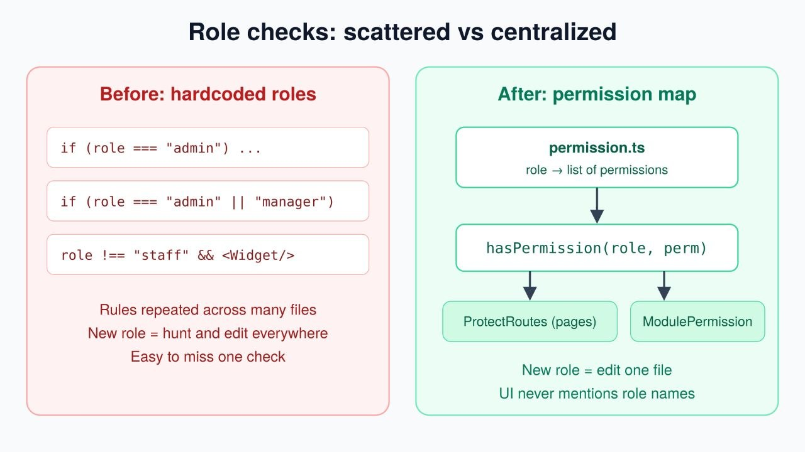
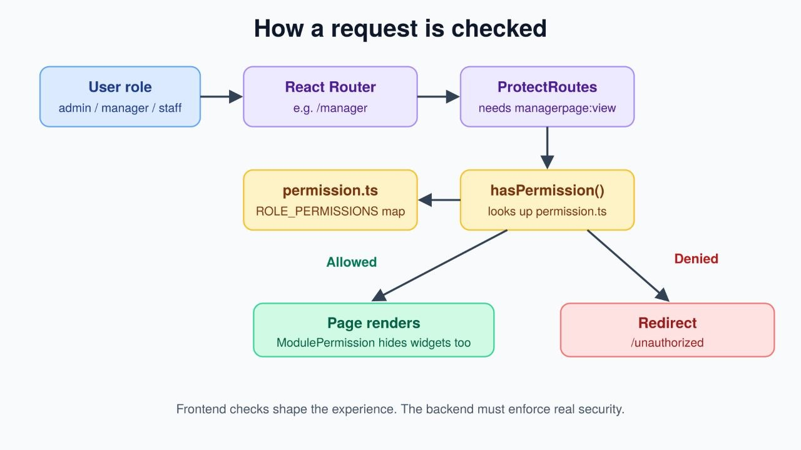

# Role-Based Access Control (RBAC) Frontend

A small React + TypeScript project that shows a clean way to do **permission-based access control** on the frontend. Instead of scattering `if (role === "admin")` checks across components, every role maps to a list of permissions in one file, and the UI only asks: *"Does this role have this permission?"*

> **Note:** Frontend checks improve the user experience, but they are not security. Always enforce access rules on the backend too.

## Features

- Three roles: `admin`, `manager`, `staff`
- Single source of truth for permissions (`src/permission.ts`)
- **Route protection:** unauthorized users are redirected to `/unauthorized`
- **Component protection:** widgets are hidden when the role lacks permission
- Fully typed with TypeScript

## Tech Stack

- React 19
- TypeScript
- React Router
- Vite

## How It Works

```
User role -> React Router -> ProtectRoutes -> hasPermission() -> permission.ts
                                  |
                  Allowed: page renders (ModulePermission hides widgets)
                  Denied:  redirect to /unauthorized
```

1. `permission.ts` maps each role to its permissions (e.g. `managerpage:view`).
2. `hasPermission(role, permission)` checks that map.
3. `ProtectRoutes` wraps routes and redirects when access is denied.
4. `ModulePermission` wraps UI pieces and renders nothing when access is denied.

## Project Structure

```
src/
├── components/
│   ├── permission/ModulePermission.tsx   # Shows/hides UI by permission
│   └── routes/ProtectRoutes.tsx          # Guards routes by permission
├── helpers/permissionChecker.ts          # hasPermission(role, permission)
├── pages/                                # Login, Dashboard, Admin, Manager, Staff, Unauthorized
├── constants.ts                          # Current role (hardcoded for demo)
├── permission.ts                         # Roles and ROLE_PERMISSIONS map
└── App.tsx                               # Routes and guards
```

## Access Matrix

| Access       | Admin | Manager | Staff |
| ------------ | :---: | :-----: | :---: |
| Dashboard    |  Yes  |   Yes   |  Yes  |
| Admin page   |  Yes  |   No    |  No   |
| Manager page |  Yes  |   Yes   |  No   |
| Staff page   |  Yes  |   Yes   |  Yes  |
| Component 1  |  Yes  |   No    |  No   |
| Component 2  |  Yes  |   Yes   |  No   |
| Component 3  |  Yes  |   Yes   |  Yes  |
| Component 4  |  Yes  |   No    |  Yes  |

## Try It

The active role is set in `src/constants.ts`:

```ts
export const role: ROLES = "manager"
```

Change it to `"admin"` or `"staff"`, then visit `/dashboard`, `/admin`, `/manager` and `/staff` to see the access rules in action.

## Adding a New Role or Permission

1. Add the role to the `ROLES` type in `src/permission.ts`.
2. Add its permission list to `ROLE_PERMISSIONS`.
3. Wrap routes with `<ProtectRoutes permission="..." />` or UI with `<ModulePermission permission="...">`.

## Current Limitations

- The role is hardcoded; there is no real authentication yet.
- `Login` is a placeholder page.
- No backend or API integration.

## Roadmap

- Real login and token-based authentication
- Load the role from the authenticated user
- Backend enforcement of the same permissions

## Flow Diagrams



## Author

[Ajinkya Veer](https://github.com/AjinkyaVeer007)
